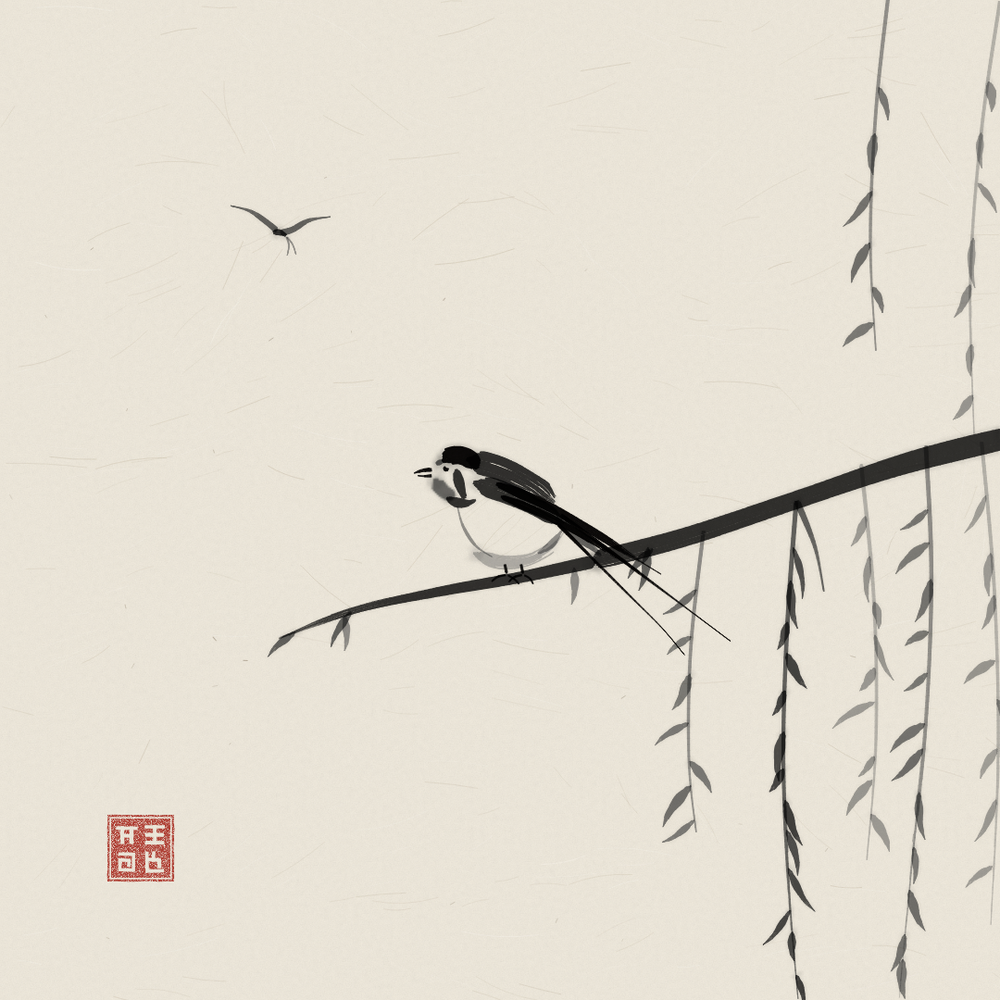

# Andorinha no salgueiro

Uma andorinha-das-chaminés pousada num ramo de salgueiro, a olhar para outra que ainda voa,
pintada em sumi-e (tinta sobre papel xuan) com o motor anidoodle. Tudo é código: cada pincelada
é uma função, sem imagens geradas.



Para voltar a desenhar (o mesmo md5 em qualquer máquina):

```bash
node skills/anidoodle/engine/tools/scaffold.mjs ~/art --still andorinha
cp drawings/andorinha/andorinha.ts ~/art/src/canvas-core/andorinha.ts
cd ~/art && npm install && node tools/still.mjs andorinha --out out/andorinha.png --scale 2
```
